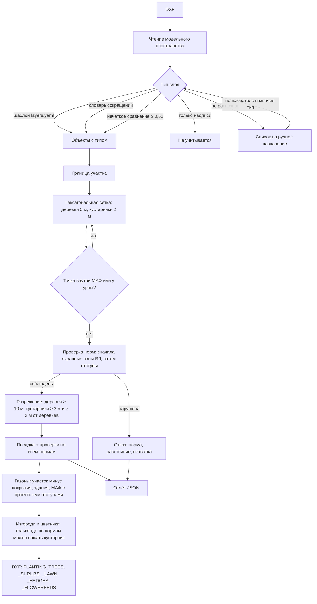

# Зелёный план

Сервис автоматического проектирования озеленения по подоснове DXF с учётом подземных и надземных инженерных сетей. Задача № 3 ДПиООС, ЛЦТ‑2026, команда «СПКБ Омега».

На вход — DXF с сетями, зданиями, покрытиями и границей участка. На выход — копия того же DXF, в которой на отдельных слоях расставлены деревья (`PLANTING_TREES`), кустарники (`PLANTING_SHRUBS`), газоны (`PLANTING_LAWN`), живые изгороди (`PLANTING_HEDGES`) и цветники (`PLANTING_FLOWERBEDS`), и отчёт, где у каждой посадки есть проверка по каждой норме: расстояние до ближайшего объекта, требование и пункт нормативного акта.

## 1. Назначение и границы MVP

Что сервис делает:

- читает DXF (модельное пространство), распознаёт слои по названию и содержимому, разрешает назначить тип слою вручную;
- определяет границу участка: слой границы → выпуклая оболочка объектов → полоса 20 м вдоль объектов для протяжённых чертежей;
- расставляет деревья и кустарники по гексагональной сетке и отбрасывает точки, нарушающие нормы;
- выделяет газоны (травянистые покрытия) и добавляет элементы сквера: живые изгороди вдоль проездов и тротуаров и цветники в глубине крупных газонов;
- объясняет каждое решение: для посадки — все проверки с запасом до нормы, для отклонённой точки — какая норма нарушена и на сколько;
- даёт поправить план вручную: перенести, удалить, добавить посадку с мгновенной проверкой, сохранить правки в отдельный DXF;
- показывает план в 2D и в 3D;
- рисует ИИ‑иллюстрацию участка по параметрам рассчитанного плана: YandexART, GigaChat (Kandinsky), Fusion Brain или, без ключей, Pollinations.

Чего MVP не делает: не подбирает породы, не считает инсоляцию и почвы, не учитывает высоту крон и диаметр кроны больше 5 м.

## 2. Архитектура

```
greenplan/
├── greenplan-backend/          Python 3.11+
│   ├── api.py                  HTTP API (FastAPI)
│   ├── greenplan/
│   │   ├── parser/             чтение DXF, геометрия, распознавание типов слоёв
│   │   ├── config/             словарь слоёв, ручные назначения
│   │   ├── constraints/        граница участка, зоны
│   │   ├── planner/            сетка, проверка норм, индекс объектов
│   │   ├── rules/              загрузка справочника норм
│   │   ├── writer/             запись DXF и отчёта
│   │   ├── pipeline.py         сквозной расчёт
│   │   └── cli.py              командная строка
│   ├── data/rules/regulations.yaml   справочник норм с источниками
│   ├── data/rules/planting.yaml      параметры посадки
│   ├── data/config/layers.yaml       шаблоны имён слоёв
│   ├── samples/                тестовые подосновы организаторов
│   └── tests/
├── greenplan-frontend/         React 19 + TypeScript + Vite
└── docker-compose.yml
```

Контейнеры: `api` (uvicorn, порт 8000) и `web` (nginx со сборкой фронтенда, порт 8080; запросы `/api/*` проксируются в `api`). Результаты расчётов хранятся в томе `runs`.

## 3. Алгоритм



**Распознавание слоёв.** Имя слоя очищается от префикса внешней ссылки (`$0$`), режется на токены, числа и маркировки (`1Х63ММ`, `К1`) отбрасываются, токены, которые встречаются больше чем в 60 % слоёв файла (общий префикс проекта, например `ДВ_ГП`), не учитываются. Дальше по порядку: шаблоны из `layers.yaml`, словарь сокращений (`БР`, `ВЛ`, `КЛ`, `НО`, `ОПОРА`, `ГАЗОН`…), нечёткое сравнение по триграммам. Слой, на котором только надписи и размеры, считается оформлением. Блоки на нераспознанных слоях получают тип по имени блока (`УРНА`, `СКАМЬЯ`, `ОПОРА`…). Слои типов покрытий из ведомости (`ТИП_1`, `ГП_2…`) считаются проездом, тротуарные типы — тротуаром. Для ВЛ класс напряжения берётся из имени слоя (`0,4 кВ`, `НО`, `10 кВ`, `ВЛ‑110`); если класса нет, применяется консервативная зона 10 м. Остальное попадает в список нераспознанных — их можно назначить в интерфейсе или флагом `--override`.

**Геометрия.** Полилинии, линии, дуги, сплайны, штриховки (по контуру), блоки (разбиваются на составляющие). Опоры освещения, урны и опоры ВЛ берутся точкой вставки блока. Урны распознаются по имени блока.

**Граница участка.** Замкнутый контур со слоя границы, указанного пользователем или распознанного. Если его нет — выпуклая оболочка объектов без выбросов (объекты дальше десяти медианных расстояний от центра чертежа отбрасываются). Если оболочка больше 25 га, чертёж считается протяжённым (улица, трасса), и границей становится полоса 20 м вдоль объектов.

**Проверка норм.** Расстояние считается от центра посадки до ближайшей точки объекта в плане. Для каждого типа объектов строится пространственный индекс STRtree, поэтому одна проверка — это несколько поисков ближайшего соседа. Порядок: запретные зоны (охранные зоны ВЛ), затем отступы по убыванию. Первая нарушенная норма становится причиной отказа.

**Интерпретируемость.** У каждой посадки в отчёте и в интерфейсе есть список проверок: норма, фактическое расстояние, запас, акт и пункт. Нормы, для которых в чертеже нет объектов, перечислены отдельно; нормы «не нормируется» показаны с фактическим расстоянием. В интерфейсе при выборе посадки на плане рисуются размерные линии до ближайших объектов.

### Справочник норм

`data/rules/regulations.yaml`. Правило применяется, только если у него `verified: true` и указаны акт и пункт; иначе загрузчик его пропускает или останавливает расчёт с ошибкой.

| Объект | Дерево, м | Кустарник, м |
|---|---|---|
| Газопровод, канализация | 1,5 | не нормируется |
| Водопровод, дренаж | 2,0 | не нормируется |
| Теплосеть | 2,0 | 1,0 |
| Силовой кабель, связь | 2,0 | 0,7 |
| Наружная стена здания | 5,0 | 1,5 |
| Край проезжей части | 2,0 | 1,0 |
| Край тротуара, дорожки | 0,7 | 0,5 |
| Опора освещения | 4,0 | не нормируется |
| Ось трамвайных путей | 5,0 | 3,0 |
| Подпорная стенка | 3,0 | 1,0 |
| Подошва откоса, террасы | 1,0 | 0,5 |

Источник: ППМ от 10.09.2002 № 743‑ПП, прил. 1, п. 3.6.3, табл. 3.6.1 (воспроизводит МГСН 1.01‑99).

Охранные зоны ВЛ, посадка запрещена: до 1 кВ — 2 м, 1–20 кВ — 10 м, 35 кВ — 15 м, 110 кВ — 20 м. Источник: ПП РФ от 24.02.2009 № 160, Правила п. 10 подп. «в», Приложение подп. «а».

У каждого правила в справочнике есть `source_url` — ссылка на текст таблицы. Деревья с широкой кроной, затеняющие жилые помещения, по примечанию 3 к таблице сажают не ближе 10 м от стены; сервис это показывает в примечании к норме, но породу не выбирает.

### Параметры посадки

`data/rules/planting.yaml`: шаг сетки деревьев 5 м, минимальное расстояние между деревьями 10 м, отступ от урн 0,1 м; шаг сетки кустарников 2 м, между кустарниками 3 м, от деревьев 2 м. Это проектные параметры, а не нормы, их можно менять.

### Газоны и элементы сквера

Раздел `greening` в том же `planting.yaml`.

- **Газон** — участок за вычетом проездов, тротуаров, зданий, МАФ, трамвайных путей и подпорных стенок с отступами от их кромок: проезд 0,5 м, тротуар 0,3 м, стена здания 1,0 м (отмостка), МАФ 0,3 м, трамвай 2,0 м, подпорная стенка 0,5 м. Табл. 3.6.1 расстояний для газонов не задаёт, поэтому отступы проектные. Над сетями газон допустим. В DXF — штриховка GRASS на слое `PLANTING_LAWN`.
- **Живая изгородь** — линия на расстоянии нормы для кустарника плюс 0,3 м от кромки тротуара или проезда, внутри газона. Из неё вырезаны все места, где кустарник сажать нельзя: зоны норм табл. 3.6.1 для кустарников (сети, здания, опоры) и охранные зоны ВЛ, а также 2 м вокруг деревьев. Короче 8 м не ставится. Кустарники ближе 1,5 м к изгороди убираются — изгородь их заменяет. В DXF — полилиния шириной 0,8 м на слое `PLANTING_HEDGES`.
- **Цветник** — круг радиусом 2,5 м в глубине газона площадью от 400 м², один на каждые 4000 м², не больше 20 на участок. Ставится только там, где можно сажать кустарник, не ближе 1 м от любых подземных сетей (даже тех, где кустарник не нормируется — чтобы не перекапывать трассу), не ближе 2,5 м от деревьев и в стороне от изгородей. Кустарники внутри цветника убираются. В DXF — окружность и штриховка на слое `PLANTING_FLOWERBEDS`.

## 4. Методы и библиотеки

| Что | Чем | Ссылка |
|---|---|---|
| Чтение и запись DXF | ezdxf | https://ezdxf.readthedocs.io |
| Геометрия, буферы, пространственный индекс STRtree | Shapely 2 | https://shapely.readthedocs.io |
| Сетка кандидатов, векторная проверка «внутри полигона» | NumPy, `shapely.contains_xy` | https://numpy.org |
| Справочники | PyYAML | https://pyyaml.org |
| HTTP API и Swagger | FastAPI, Uvicorn | https://fastapi.tiangolo.com |
| Интерфейс | React, TypeScript, Vite | https://react.dev, https://vite.dev |
| 2D‑план | Canvas 2D | — |
| 3D‑просмотр | three.js, @react-three/fiber, drei | https://threejs.org |
| Тесты | pytest | https://pytest.org |

Нечёткое сравнение имён слоёв — коэффициент Дайса по триграммам символов, без внешних моделей.

## 5. Сборка и запуск под Linux

### Docker

```bash
git clone https://github.com/alksgrs/lct.git
cd lct/greenplan
docker compose up --build
```

Интерфейс: http://localhost:8080. API: http://localhost:8000, Swagger: http://localhost:8000/docs.

### Без Docker

Нужны Python 3.11+ и Node.js 20+.

```bash
cd greenplan-backend
python3 -m venv .venv
. .venv/bin/activate
pip install -r requirements-dev.txt
uvicorn api:app --host 127.0.0.1 --port 8000
```

Во втором терминале:

```bash
cd greenplan-frontend
npm ci
npm run dev
```

Интерфейс: http://localhost:5173. Адрес API задаётся переменной `VITE_API_URL` (по умолчанию `http://127.0.0.1:8000`).

### Командная строка

```bash
cd greenplan-backend
python -m greenplan.cli "samples/10001759 НО 3-я Парковая ул.dxf" --species all --output out.dxf
```

Рядом с `out.dxf` появится `out.json` с обоснованием. Флаги: `--species tree|shrub|all`, `--boundary-layer СЛОЙ`, `--override "СЛОЙ=ТИП"` (можно несколько раз), `--rules`, `--planting`, `--layers`. Через Docker: `docker compose run --rm -v "$PWD:/work" api python -m greenplan.cli /work/plan.dxf --species all --output /work/out.dxf`.

### Тесты

```bash
cd greenplan-backend
pytest
```

Набор включает прогон трёх подоснов организаторов с независимой проверкой: каждая посадка сравнивается с каждой нормой по исходной геометрии.

### Переменные окружения API

| Переменная | Назначение | По умолчанию |
|---|---|---|
| `GREENPLAN_RUNS_DIR` | каталог расчётов | `.greenplan_runs` |
| `GREENPLAN_CORS` | разрешённые источники, через запятую | localhost:5173, localhost:8080 |
| `GREENPLAN_RULES`, `GREENPLAN_PLANTING`, `GREENPLAN_LAYERS` | пути к справочникам | `data/…` |
| `GREENPLAN_AI_PROVIDER` | генераторы и порядок через запятую: `yandexart`, `gigachat`, `kandinsky`, `pollinations` | все настроенные в этом порядке |
| `GREENPLAN_AI_TIMEOUT` | сколько ждать картинку от одного генератора, с | 120 |
| `YANDEX_FOLDER_ID` | идентификатор каталога Yandex Cloud для YandexART | — |
| `YANDEX_OAUTH_TOKEN` | OAuth‑токен аккаунта Яндекса, обменивается на IAM‑токен сам | — |
| `YANDEX_API_KEY` | секрет API‑ключа сервисного аккаунта (`AQVN…`) | — |
| `YANDEX_IAM_TOKEN` | готовый IAM‑токен (`t1.…`), живёт до 12 часов | — |
| `GIGACHAT_AUTH_KEY` | «Ключ авторизации» проекта GigaChat API | — |
| `GIGACHAT_SCOPE` | `GIGACHAT_API_PERS` для физлиц, `GIGACHAT_API_B2B` или `GIGACHAT_API_CORP` | `GIGACHAT_API_PERS` |
| `GIGACHAT_CA_BUNDLE`, `GIGACHAT_VERIFY_SSL` | путь к сертификату Минцифры или `0`, чтобы не проверять сертификат | проверка включена |
| `FUSIONBRAIN_KEY`, `FUSIONBRAIN_SECRET` | ключи Kandinsky на fusionbrain.ai → API | — |
| `POLLINATIONS` | `0` — не обращаться к Pollinations | включён |
| `POLLINATIONS_KEY` | ключ Pollinations, снимает ограничение частоты | — |

Для Docker ключи кладутся в `.env` рядом с `docker-compose.yml` (образец — `.env.example`).

### ИИ‑визуализация: какой генератор подключить

Генераторы опрашиваются по очереди: YandexART → GigaChat → Kandinsky на Fusion Brain → Pollinations. Если первый отказал или не ответил, картинку рисует следующий, а панель показывает, кто не сработал и почему. Набор и порядок задаются в `GREENPLAN_AI_PROVIDER`, например `gigachat,pollinations`. В панели можно выбрать генератор вручную.

Без единого ключа работает Pollinations (модель FLUX): не чаще раза в 15 секунд, возможен водяной знак, сервис зарубежный — из России может понадобиться VPN. Описание для него уходит на английском, остальным — на русском.

Проверить ключи без интерфейса — команда рисует тестовый участок каждым настроенным генератором, сохраняет `check_<генератор>.jpg` и печатает причину, если не получилось:

```bash
cd greenplan-backend
python -m greenplan.visual
python -m greenplan.visual yandexart
docker compose exec api python -m greenplan.visual
```

**YandexART** (Яндекс).
1. В консоли Yandex Cloud должен быть активный платёжный аккаунт; пробный грант подходит. Без него YandexART отвечает 403.
2. Идентификатор каталога (`b1g…`, страница каталога в консоли) — в `YANDEX_FOLDER_ID`. Нужен именно каталог, не облако.
3. Самый короткий путь — OAuth‑токен своего аккаунта: открыть `https://oauth.yandex.ru/authorize?response_type=token&client_id=1a6990aa636648e9b2ef855fa7bec2fb`, токен `y0_…` положить в `YANDEX_OAUTH_TOKEN`. Владельцу облака дополнительные роли не нужны.
4. Через сервисный аккаунт: роль `ai.imageGeneration.user` на каталог, API‑ключ с областью действия `yc.ai.imageGeneration.execute`. В `YANDEX_API_KEY` кладётся секрет (`AQVN…`), а не идентификатор ключа (`aje…`).

**GigaChat** (Сбер). Картинки в GigaChat рисует Kandinsky — та же модель, что на fusionbrain.ai.
1. developers.sber.ru → вход по Сбер ID → проект GigaChat API для физлица.
2. В проекте получить «Ключ авторизации» и положить в `GIGACHAT_AUTH_KEY`.
3. Серверы Сбера подписаны сертификатом Минцифры. Если проверка сертификата не проходит, панель так и напишет: скачать корневой сертификат на gu-st.ru и указать путь в `GIGACHAT_CA_BUNDLE` или, для демо, задать `GIGACHAT_VERIFY_SSL=0`.

**Kandinsky на Fusion Brain** (Сбер): ключ и секрет на fusionbrain.ai → API. Если сайт не открывается, тот же Kandinsky доступен через GigaChat.

## 6. Работа с сервисом

1. Загрузить DXF. Справа на стартовом экране — таблица норм, по которым идёт проверка.
2. Дождаться расчёта (подоснова на 5–10 га — 5–25 секунд).
3. На вкладке «Нормы» — каждая применённая норма с ближайшей посадкой и запасом, отсортировано от самой напряжённой. Число отказов по норме кликабельно: отказы появятся на плане.
4. Щелчок по посадке открывает вкладку «Точка»: проверка по каждой норме и размерные линии на плане. Газоны, изгороди и цветники показаны на плане и в 3D, их площадь, длина и число — в сводке сверху, пояснение — внизу вкладки «Нормы».
5. Если есть нераспознанные слои — вкладка «Слои»: назначить тип, при необходимости выбрать слой границы, нажать «Пересчитать».
6. Правка: «Перемещать», «+ Дерево», «+ Кустарник», Delete — удалить, Ctrl+Z — отменить. Каждая правка проверяется сервером; сохранить можно, только если нарушений нет.
7. В режиме 3D — «ИИ‑визуализация»: выбрать сезон, при желании генератор, и нажать «Сгенерировать». Картинка строится по описанию плана (тип участка, объекты, число посадок), а не по точной геометрии, поэтому это иллюстрация, а не чертёж.
8. Скачать: «DXF» — как рассчитал сервис, «DXF с правками» — после сохранения, «Обоснование» — JSON по каждой посадке. DXF собирается при первом скачивании, на крупной подоснове это до 20 секунд.

## 7. API

Полное описание — Swagger на `/docs`.

| Метод | Путь | Что делает |
|---|---|---|
| GET | `/health` | доступность |
| GET | `/rules` | применяемые и неподтверждённые нормы |
| POST | `/runs` | загрузить DXF (`multipart/form-data`, поле `file`, необязательное `boundary_layer`) |
| GET | `/runs/{id}` | статус, этап, процент; при ошибке — список слоёв для ручного назначения |
| GET | `/runs/{id}/result` | посадки, отказы, нормы с фактическими расстояниями, слои, граница, геометрия подосновы |
| POST | `/runs/{id}/layers` | `{"overrides": {"СЛОЙ": "ТИП"}, "boundary_layer": "СЛОЙ"}` — пересчёт |
| POST | `/runs/{id}/check` | `{"x", "y", "species_type"}` — проверка одной точки по всем нормам |
| POST | `/runs/{id}/validate-edits` | проверить правки: `placements` (перенос), `added`, `removed` |
| POST | `/runs/{id}/save-edits` | сохранить правки в отдельный DXF |
| GET | `/runs/{id}/original-dxf`, `/edited-dxf`, `/dxf` | DXF с посадками |
| GET | `/runs/{id}/report` | обоснование по каждой посадке |
| GET | `/layers/kinds` | типы, которые можно назначить слою |
| GET | `/visualize/status` | какие генераторы изображений настроены и в каком порядке |
| POST | `/runs/{id}/visualize` | ИИ‑иллюстрация участка, `season`: `summer`, `autumn` или `winter`, `provider` — по желанию |

## 8. Ограничения, допущения, известные ошибки

- Координаты чертежа считаются метрами. Читается только модельное пространство; внешние ссылки не подгружаются.
- Расстояние меряется от центра посадки до объекта в плане, как он нарисован. Если сеть нарисована осью, а норма считается от стенки трубы или края канала, запас завышен на половину ширины сети.
- Охранная зона ВЛ по ПП № 160 отсчитывается от крайних проводов. Если в чертеже только ось линии, зона получается меньше на половину расстояния между крайними проводами.
- Класс напряжения ВЛ определяется по имени слоя. Без класса применяется зона 10 м.
- Сервис рассчитан по нормам табл. 3.6.1 для деревьев с кроной до 5 м. Для крупных крон отступ нужно увеличивать.
- Для зданий школ и детских садов ППМ 743‑ПП требует 10 м от стены; тип здания в DXF не определяется, применяется общая норма 5 м.
- Нераспознанные слои в проверке не участвуют. Сервис показывает их и просит назначить тип, но сам их не угадывает.
- Автоматическая граница (выпуклая оболочка, полоса 20 м) — приближение. Для точного результата нужен слой с замкнутым контуром.
- Высота зданий в 3D условная (9 м), кроны 3–5 м.
- Газон строится от распознанных покрытий. На подоснове, где дорог нет совсем, газоном считается вся полоса вдоль улицы.
- Расчёты хранятся в памяти процесса и в каталоге `runs`; после перезапуска API ссылки на старые расчёты не работают. Авторизации нет.
- Для правил «край тротуара», «опора освещения — кустарник», «трамвай», «подпорная стенка» и «откос» в справочнике указаны нормативный источник и пункт, а также установлена отметка verified: true; поле verified_by не заполнено.
- ИИ‑иллюстрация зависит от внешних сервисов; все генераторы принимают только текст, поэтому картинка не повторяет геометрию плана. Pollinations без ключа ограничен по частоте и может поставить водяной знак.
